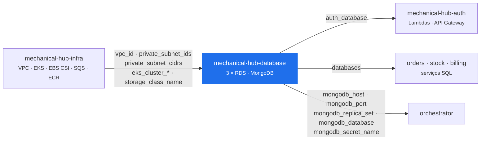
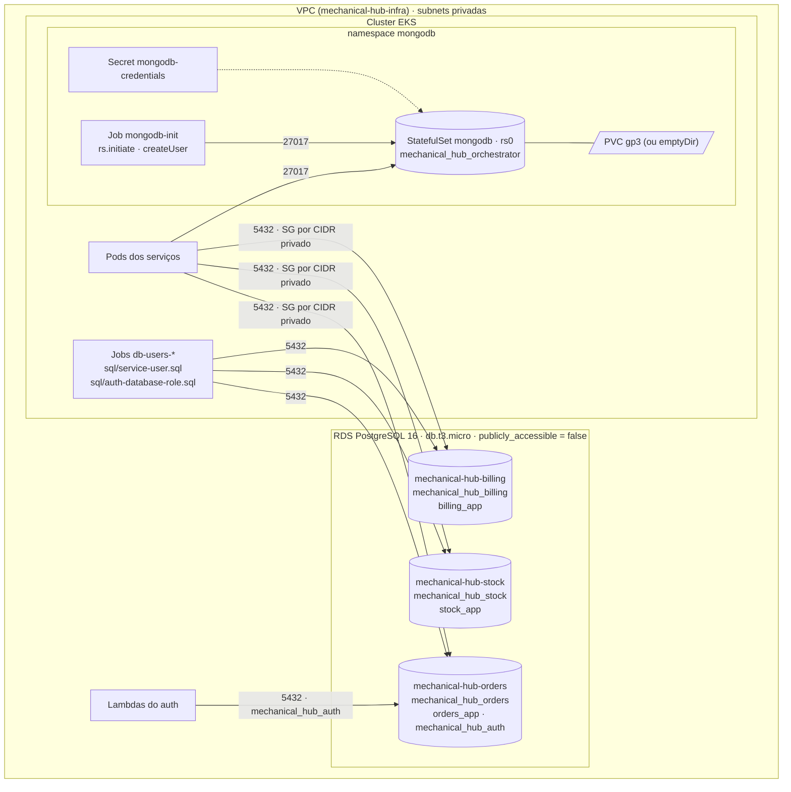

# mechanical-hub-database

Provisionamento da camada de persistência da plataforma Mechanical Hub, em Terraform com state remoto próprio:

- **Uma instância RDS PostgreSQL por serviço SQL** (`orders`, `stock`, `billing`), cada uma com DB subnet group e security group próprios.
- **MongoDB do `orchestrator`**, como StatefulSet de um nó em replica set (`rs0`) no cluster EKS do `mechanical-hub-infra`.
- **Usuários de banco** de cada serviço e a role `mechanical_hub_auth`, usada pela autenticação (`sql/`).

A divisão de responsabilidades entre repositórios está na ADR-0002; a escolha de um banco por microsserviço, na ADR-0004 (repositório `MechanicalHub`).

---

## Recorte do repositório

O banco tem ciclo de vida próprio e é o recurso de maior criticidade e menor tolerância a recriação acidental. Isolá-lo em um repositório com pipeline próprio garante que um `terraform apply` de qualquer outro componente não tenha como afetá-lo.

**Pertence a este repositório:**

- As três instâncias RDS PostgreSQL, seus DB subnet groups e security groups.
- O MongoDB do `orchestrator`: namespace, Secret de credenciais, Service headless, StatefulSet e Job de inicialização do replica set.
- Usuário de cada serviço (`sql/service-user.sql`) e a role de privilégio mínimo da autenticação (`sql/auth-database-role.sql`).

**Não pertence:**

| Recurso | Repositório |
| --- | --- |
| VPC, subnets, NAT/Internet Gateway | `mechanical-hub-infra` |
| Cluster EKS, node group, driver EBS CSI e StorageClass `gp3` | `mechanical-hub-infra` |
| Filas SQS e ECR | `mechanical-hub-infra` |
| Lambdas de autenticação e API Gateway | `mechanical-hub-auth` |
| Tabelas, índices e seeds (migrations Flyway) | `mechanical-hub-orders`, `-stock`, `-billing` |
| Índices e TTL do MongoDB | `mechanical-hub-orchestrator` |

Este repositório entrega os bancos vazios e os usuários; o schema é de cada serviço.

## Tecnologias

- **Terraform** >= 1.7.0; providers AWS ~> 5.0, Kubernetes ~> 2.27 e Random ~> 3.6
- **AWS RDS PostgreSQL 16**, 3 × `db.t3.micro`, 20 GB cada, criptografado em repouso, sem acesso público
- **MongoDB 7** (`public.ecr.aws/docker/library/mongo:7.0`), 1 réplica, ~0,25 vCPU / 0,75 GiB de request, PVC de 5 GiB em `gp3`
- **State remoto** em S3, chave `mechanical-hub-database/terraform.tfstate`
- **GitHub Actions** para validação, testes e apply
- **LocalStack** para os testes de integração

---

## Um banco por serviço

| Serviço | Banco | Onde | Identificador / host | Usuário da aplicação | Senha da aplicação |
| --- | --- | --- | --- | --- | --- |
| `orders` | `mechanical_hub_orders` | RDS | `mechanical-hub-orders-<ambiente>` | `orders_app` | secret `ORDERS_DB_APP_PASSWORD` |
| `stock` | `mechanical_hub_stock` | RDS | `mechanical-hub-stock-<ambiente>` | `stock_app` | secret `STOCK_DB_APP_PASSWORD` |
| `billing` | `mechanical_hub_billing` | RDS | `mechanical-hub-billing-<ambiente>` | `billing_app` | secret `BILLING_DB_APP_PASSWORD` |
| `orchestrator` | `mechanical_hub_orchestrator` | MongoDB no EKS | `mongodb-0.mongodb.mongodb.svc.cluster.local` | `orchestrator_app` | Secret `mongodb/mongodb-credentials` |
| autenticação | `mechanical_hub_orders` | RDS do `orders` | — | `mechanical_hub_auth` | secret `AUTH_DB_PASSWORD` |

Nenhum serviço acessa o banco de outro: cada um tem instância e credencial próprias. A instância do `orders` assume o papel do antigo banco do monólito e também atende à autenticação, que lê `users` e `profiles`.

### Credenciais e onde ficam

| Credencial | Onde fica | Quem usa |
| --- | --- | --- |
| Master de cada RDS (`mechanical_hub_admin`) | Secrets `DB_PASSWORD_ORDERS`, `DB_PASSWORD_STOCK`, `DB_PASSWORD_BILLING` deste repositório | Terraform (criação da instância) e o Job que roda `sql/` |
| Usuário de cada serviço SQL | Secret `<SERVIÇO>_DB_APP_PASSWORD`, aqui e no repositório do serviço (mesmo valor) | Job de `sql/service-user.sql`; aplicação e migrations do serviço |
| `mechanical_hub_auth` | Secret `AUTH_DB_PASSWORD`, aqui e no `mechanical-hub-auth` (mesmo valor) | Job de `sql/auth-database-role.sql`; Lambda de autenticação |
| Root e `orchestrator_app` do MongoDB | Gerados pelo Terraform (`random_password`) e guardados só no Secret `mongodb-credentials` (namespace `mongodb`) e no state | Job de inicialização; pipeline do `orchestrator`, que lê `username`/`password` do Secret |

Senhas **não** transitam por output.

### Usuários e role

- `sql/service-user.sql` cria o usuário do serviço, concede `CONNECT`, revoga o acesso padrão de `PUBLIC` ao banco e transfere a propriedade do schema `public` para o usuário. As tabelas criadas pelas migrations passam a ser dele.
- `sql/auth-database-role.sql` cria `mechanical_hub_auth` só com `LOGIN` e `CONNECT` no banco do `orders`. O `GRANT SELECT` nas colunas de `users` e em `profiles` fica na migration do `mechanical-hub-orders`, que cria essas tabelas.

Os dois scripts são idempotentes: nas execuções seguintes só atualizam as senhas.

### MongoDB

- Replica set de um nó (`--replSet rs0 --keyFile`), pré-requisito das transações multi-documento do `orchestrator`. Com um nó, `majority` é o próprio nó.
- O Job `mongodb-init` faz `rs.initiate()` com o host DNS estável do pod e cria (ou atualiza) `orchestrator_app` com `readWrite` em `mechanical_hub_orchestrator`. O Kubernetes apaga o Job 10 minutos após concluído e o próximo `apply` o executa de novo — de propósito, ver abaixo.
- **Armazenamento:** PVC na StorageClass `gp3` do `mechanical-hub-infra` (EBS, `WaitForFirstConsumer`). O volume fica preso à AZ em que nasceu, e o pod volta para um nó dessa AZ quando os nós religam na sessão seguinte do Lab.
- **Sem o driver EBS CSI:** `mongodb_persistence_enabled = false` (input `mongodb_persistencia` no deploy manual) troca o PVC por `emptyDir`. Os dados somem quando o pod muda de nó; o próximo `apply` reexecuta o Job e recria replica set e usuário.
- Sem tolerância à perda do pod — aceito no Lab.

---

## Arquitetura

### Ordem de provisionamento



Cada repositório lê os valores de que precisa via `terraform_remote_state` ou dos outputs publicados pelo pipeline, nunca por hardcode de IDs ou endpoints.

### Recursos deste repositório



Cada instância RDS tem o próprio security group, com uma regra de ingress na 5432 por CIDR de subnet privada (nós do EKS e Lambdas do `auth`).

### Aplicar fora de ordem falha — de propósito

A rede e o cluster vêm do state do `mechanical-hub-infra`. Se esse state não existir e nenhum override for informado, o `plan` falha nas precondições de rede ou de cluster, antes de qualquer recurso ser criado:

```
Nao foi possivel resolver a rede.

Aplique o mechanical-hub-infra primeiro e informe o state dele:
  -var="infra_state_bucket=mechanical-hub-tfstate-<conta>"
```

O mesmo vale para a senha master faltando em `db_passwords` e para `mongodb_persistence_enabled = true` sem StorageClass resolvida. Sem essas precondições, o erro viria da API da AWS ou do Kubernetes, sem relação aparente com a causa.

---

## Ordem de execução do ambiente

1. **`terraform apply`** deste repositório (push em `main` ou Actions → Deploy → Run workflow), depois do `mechanical-hub-infra`.
2. **Usuários e role:** Actions → Deploy → Run workflow marcando `criar_usuarios_e_role`. Roda `sql/service-user.sql` nas 3 instâncias e `sql/auth-database-role.sql` na do `orders`, como Jobs no EKS (os RDS são privados). Necessário no primeiro apply e a cada recriação dos RDS.
3. **Deploy dos serviços:** as migrations do `orders` concedem o `SELECT` a `mechanical_hub_auth`, por isso a role precisa existir antes; depois, `mechanical-hub-auth`.

O MongoDB não tem passo manual: o Job de inicialização roda dentro do `apply`.

---

## Custo e lembrete de destruir

Valores aproximados em `us-east-1`, sob demanda:

| Recurso | Por hora | Por dia ligado |
| --- | --- | --- |
| 3 × RDS `db.t3.micro` PostgreSQL (~US$ 0,018/h cada) | ~US$ 0,054 | ~US$ 1,30 |
| 3 × 20 GB de armazenamento do RDS | — | ~US$ 0,23 |
| MongoDB (roda nos nós do EKS, que são do `infra`) + EBS de 5 GiB `gp3` | — | ~US$ 0,01 |

As instâncias RDS **cobram por hora mesmo fora da sessão do Lab** — não param quando os nós do EKS param. Com cerca de US$ 50 de crédito no Lab, só o RDS consome ~US$ 1,50 por dia ligado.

**Destrua fora do uso**, na ordem inversa do provisionamento (serviços → `auth` → este repositório → `infra`):

```bash
cd infra
terraform destroy -var="infra_state_bucket=mechanical-hub-tfstate-<ID_DA_CONTA>"
```

O ambiente é recriado pelos pipelines. `skip_final_snapshot = true` e `backup_retention_period = 0`: destruir apaga os dados — esperado no Lab.

---

## Outputs de contrato

Os outputs são **interface pública e estável**. Alterá-los ou removê-los é mudança quebra-compatibilidade e exige coordenação com os consumidores.

| Output | Descrição | Consumido por |
| --- | --- | --- |
| `databases` | Mapa `orders`/`stock`/`billing` → `endpoint` (host, sem porta), `port`, `db_name`, `app_username` | Pipelines dos serviços SQL |
| `auth_database` | `endpoint`, `port`, `db_name` da instância do `orders` | `mechanical-hub-auth` |
| `rds_security_group_ids` | Mapa serviço → security group | Diagnóstico |
| `mongodb_host`, `mongodb_port`, `mongodb_replica_set`, `mongodb_database` | Partes da URI do MongoDB (`authSource` = `mongodb_database`) | Pipeline do `orchestrator` |
| `mongodb_secret_name` | Secret com `username`/`password` do `orchestrator` | Pipeline do `orchestrator` |
| `mongodb_namespace` | Namespace do MongoDB e do Secret | Pipeline do `orchestrator` |
| `rds_master_usernames` | Usuário master por serviço | Job de `sql/` deste repositório |
| `vpc_id`, `private_subnet_ids`, `eks_cluster_name` | Rede e cluster efetivamente usados | Depuração; Jobs no EKS |

Os antigos `rds_*` (`rds_endpoint`, `rds_port`, `rds_db_name`, …) foram removidos: `databases` e `auth_database` os substituem.

---

## Execução local

### Pré-requisitos

- Terraform >= 1.7.0 e AWS CLI (o provider Kubernetes autentica com `aws eks get-token`)
- Credenciais AWS ativas (no AWS Academy Lab elas expiram a cada sessão)
- O `mechanical-hub-infra` já aplicado, ou rede e cluster em mãos

### Caminho recomendado — via remote state

```bash
cd infra

terraform init \
  -backend-config="bucket=mechanical-hub-tfstate-<ID_DA_CONTA>" \
  -backend-config="key=mechanical-hub-database/terraform.tfstate" \
  -backend-config="region=us-east-1"

export TF_VAR_db_passwords='{"orders":"<senha>","stock":"<senha>","billing":"<senha>"}'

terraform plan  -var="infra_state_bucket=mechanical-hub-tfstate-<ID_DA_CONTA>"
terraform apply -var="infra_state_bucket=mechanical-hub-tfstate-<ID_DA_CONTA>"
```

### Caminho de fallback — sem o state do `infra`

Os overrides têm precedência sobre o remote state:

```bash
terraform apply \
  -var='vpc_id=vpc-0123456789abcdef0' \
  -var='private_subnet_ids=["subnet-aaaa1111","subnet-bbbb2222"]' \
  -var='private_subnet_cidrs=["10.0.11.0/24","10.0.12.0/24"]' \
  -var='eks_cluster_name=mechanical-hub-production' \
  -var='eks_cluster_endpoint=https://<id>.gr7.us-east-1.eks.amazonaws.com' \
  -var='eks_cluster_ca_certificate=<CA em base64>' \
  -var='mongodb_storage_class_name=gp3'
```

As subnets precisam estar em **AZs distintas** — exigência do DB subnet group, verificada pela precondição. Este é um contorno de desenvolvimento: a cada reset do Lab os IDs mudam.

### Testes

```bash
cd infra

# Unitários — mock_provider, sem AWS, sem cluster e sem LocalStack
terraform init -backend=false -test-directory=tests/unit
terraform test -test-directory=tests/unit

# Integração — exige LocalStack em http://localhost:4566
docker run --rm -d -p 4566:4566 localstack/localstack:3
terraform init -backend=false -test-directory=tests/integration
terraform test -test-directory=tests/integration
```

O `-test-directory` é obrigatório: o `terraform test` só procura arquivos diretamente em `tests/`, e sem ele termina com "0 passed".

| Arquivo | Cobre |
| --- | --- |
| `unit/databases_unit` | 3 instâncias com identificadores distintos e não públicas; formato dos outputs; precondições de senha, `orders`, cluster e StorageClass |
| `unit/mongodb_unit` | StatefulSet com `--replSet`, 1 réplica, requests/limits e readiness; `emptyDir` sem persistência |
| `unit/rds_unit` | Módulo `rds`: regras de ingress por CIDR, instância privada e criptografada, nomes |
| `unit/network_unit` | Resolução da rede (remote state × override) |
| `unit/region_unit` | Regiões permitidas no AWS Academy |
| `integration/rds_integration` | Bancos pelo mapa de serviços no LocalStack (só o `orders`, para economizar) |

`tests/fixtures/network/` cria uma VPC mínima e `tests/fixtures/databases/` repete o `for_each` do módulo raiz — o módulo raiz inteiro não roda no LocalStack, porque também lê o state do `infra` e cria o MongoDB no EKS.

---

## Pipelines

| Workflow | Gatilho | O que faz |
| --- | --- | --- |
| `ci.yml` → `validate` | PR e push em `main` | `fmt -check`, `validate` (raiz e módulo `mongodb`), testes unitários |
| `ci.yml` → `integration` | PR e push em `main` | Testes de integração com LocalStack como service container |
| `ci.yml` → `plan` | PR em `main` | `plan` real contra a AWS e o cluster, para revisão no PR |
| `deploy.yml` → `deploy` | Push em `main`, ou manual | kubeconfig do cluster, `plan`, `apply`, outputs publicados no job e no step summary |
| `deploy.yml` → `database-users` | Só manual, marcando `criar_usuarios_e_role` | Roda os scripts de `sql/` em cada instância, via Jobs no EKS |

O `deploy.yml` usa `concurrency` sem cancelamento: dois `terraform apply` simultâneos disputariam o mesmo state.

### Secrets exigidos

Configurar em **Settings → Secrets and variables → Actions**:

| Secret | Descrição |
| --- | --- |
| `AWS_ACCESS_KEY_ID` | Credencial da sessão do AWS Academy Lab |
| `AWS_SECRET_ACCESS_KEY` | Credencial da sessão do AWS Academy Lab |
| `AWS_SESSION_TOKEN` | Token de sessão — obrigatório no Lab, que só emite credenciais temporárias |
| `AWS_ACCOUNT_ID` | ID da conta, usado para compor o nome do bucket de state |
| `DB_PASSWORD_ORDERS`, `DB_PASSWORD_STOCK`, `DB_PASSWORD_BILLING` | Senha master de cada instância, montadas em `TF_VAR_db_passwords` |
| `ORDERS_DB_APP_PASSWORD`, `STOCK_DB_APP_PASSWORD`, `BILLING_DB_APP_PASSWORD` | Senha do usuário de cada serviço. Usadas pelo job `database-users`; precisam coincidir com as do repositório de cada serviço |
| `AUTH_DB_PASSWORD` | Senha da role `mechanical_hub_auth`. Usada pelo job `database-users`; precisa coincidir com a do `mechanical-hub-auth` |

O secret `DB_PASSWORD` da Fase 3 não é mais usado.

As credenciais do AWS Academy Lab **expiram a cada sessão**. Atualize os três primeiros secrets antes de rodar qualquer pipeline.

---

## Decisões de arquitetura

### Uma instância por serviço, não um schema por serviço

Uma instância RDS por serviço SQL (ADR-0004; `infrastructure.md` §5): o isolamento entre serviços é físico, não depende de grants entre schemas. O preço é o custo — três instâncias cobrando por hora (ver [Custo](#custo-e-lembrete-de-destruir)). As instâncias foram recriadas do zero na Fase 4: as migrations do `orders` começam em V1 e não podem herdar o `flyway_schema_history` do monólito.

### MongoDB no EKS, não DocumentDB

DocumentDB não é liberado no AWS Academy Lab. O MongoDB roda como StatefulSet no cluster do `infra`, com replica set de um nó — o mínimo para transações multi-documento.

### Liberação de acesso por CIDR, não por security group

As Lambdas do `auth` são criadas depois deste repositório; referenciar o security group delas criaria dependência circular. A ADR-0002 libera a 5432 pelos **CIDRs das subnets privadas**, onde estão todos os consumidores, e nenhum banco é público. Há ainda `allowed_security_group_ids`, vazio por padrão.

**Contrapartida:** é menos granular que liberar por security group de origem. Se cargas não confiáveis passarem a residir nas subnets privadas, a decisão precisa ser revisitada.

### Sem RDS Proxy, Multi-AZ, réplicas ou backup

O Lab não libera os recursos de que o RDS Proxy depende (IAM dedicado e Secrets Manager), e o orçamento não comporta Multi-AZ, réplicas nem backup automatizado. São variáveis (`db_multi_az`, `db_backup_retention_period`) — em um ambiente real, `true` e ao menos 7 dias.

---

## Estrutura

```
sql/
├── service-user.sql             # usuário de cada serviço, dono do schema public
└── auth-database-role.sql       # role mechanical_hub_auth (LOGIN + CONNECT)
infra/
├── providers.tf                 # providers aws/kubernetes/random e backend S3
├── main.tf                      # remote state do infra, precondições, módulos rds e mongodb
├── variables.tf                 # mapa databases, senhas, overrides de rede e cluster, MongoDB
├── outputs.tf                   # contrato entre repositórios
├── modules/
│   ├── rds/                     # subnet group, security group, instância (uma por serviço)
│   └── mongodb/                 # namespace, Secret, Service, StatefulSet, Job de init
└── tests/
    ├── unit/                    # mock_provider, sem AWS
    ├── integration/             # LocalStack
    └── fixtures/                # rede mínima e bancos pelo mapa de serviços
```

## Referências

No repositório `MechanicalHub`:

- `adr/ADR-0004-banco-de-dados-por-microsservico.md` — um banco por microsserviço, MongoDB no `orchestrator`
- `infrastructure/infrastructure.md` §3 (MongoDB, armazenamento, orçamento), §5 (bancos), §7 (ordem)
- `design/data_model.md` §5 — coleções do `orchestrator`
- `planning/mechanical-hub-database-spec.md` — spec desta fase
